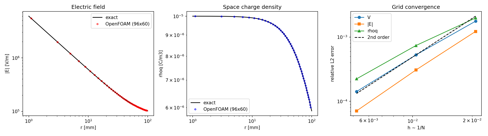
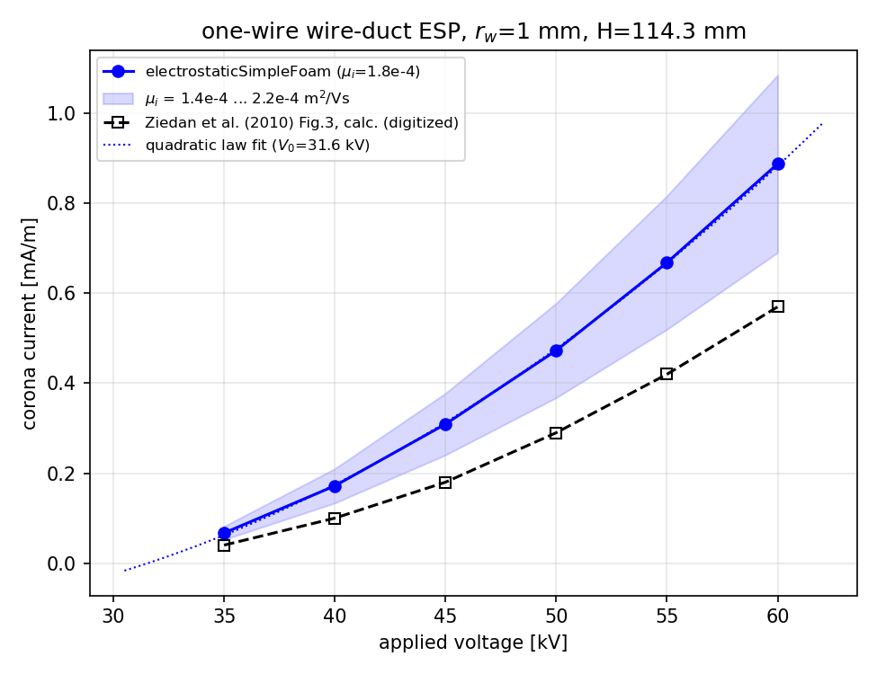
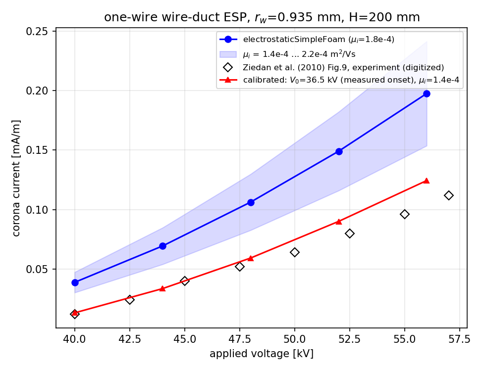
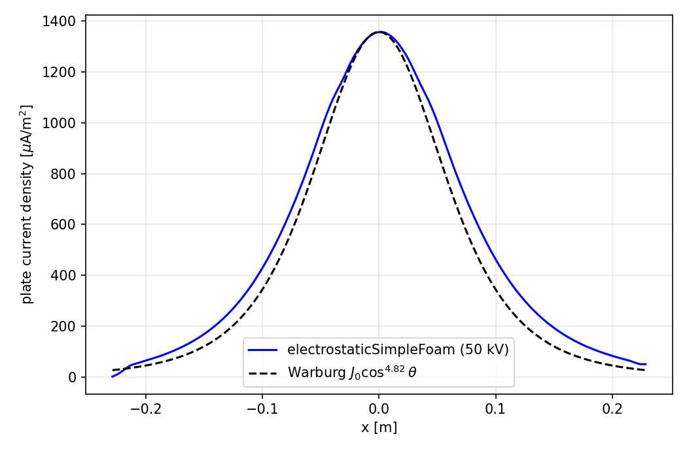
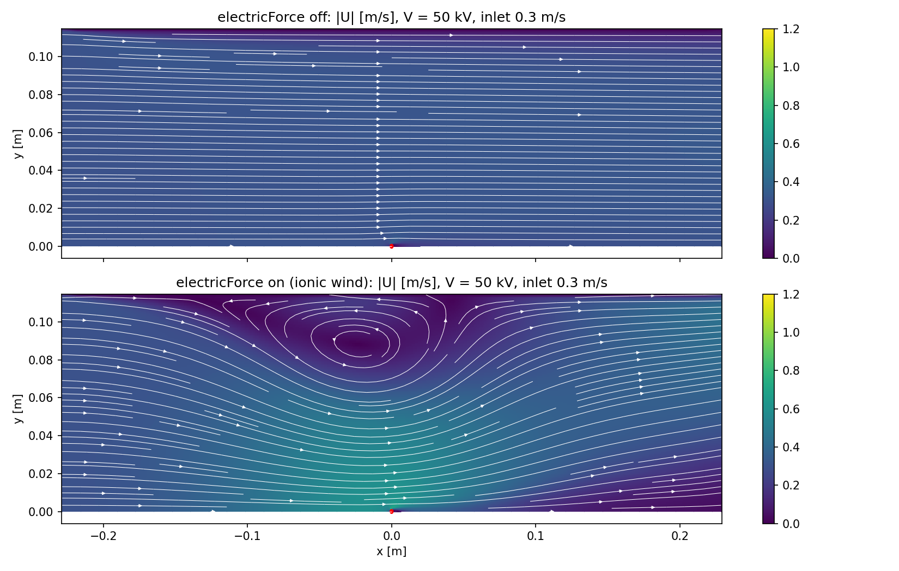
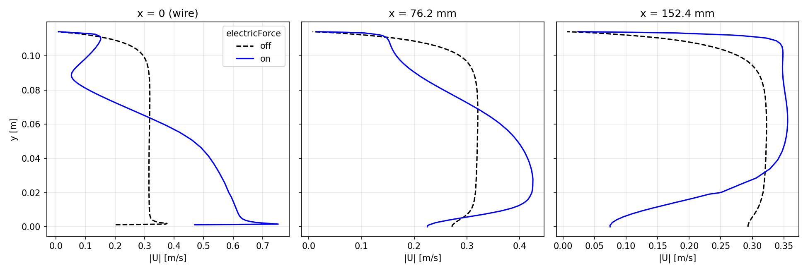

# Verification and Validation Report: `electrostaticSimpleFoam`

**Solver:** `electrostaticSimpleFoam` — steady-state incompressible RANS + DC corona
electrostatics (unipolar ion drift-diffusion) with two-way EHD coupling
(ionic wind).

**Platform:** OpenFOAM v2412, WSL2 Ubuntu 24.04.

**Date:** 2026-06-11.

---

## 1. Solver description

The solver combines `simpleFoam` and `electrostaticFoam` into one segregated
steady solver. Per SIMPLE iteration it solves, in order:

| # | Equation | Field |
| --- | --- | ---|
| 1 | `laplacian(V) = -rhoq/epsilon0` (Gauss law) | electric potential `V` [V] |
| 2 | `div((phi + rhoqFlux), rhoq) - laplacian(Dq, rhoq) = 0` | space charge `rhoq` [C/m3] |
| 3 | momentum predictor with EHD source `rhoq*E/rhoFluid` [m/s2] | `U` |
| 4 | SIMPLE pressure correction (unchanged from simpleFoam) | `p` |
| 5 | turbulence model update | `k`, `epsilon`, `nut` |

`rhoqFlux = -muq*magSf*snGrad(V)` is the ion drift face flux (`muq` = ion
mobility); `phi` is the volumetric flow flux, so charge is transported by
drift + convection + diffusion. The EHD body force enters the momentum
equation divided by the gas density `rhoFluid` because simpleFoam solves the
density-normalised (kinematic-pressure) momentum equation. A runtime switch
`electricForce on/off` in `constant/electricProperties` enables/disables the
force without touching the electrostatics, allowing one-way vs two-way
coupling comparisons. Field names were chosen to avoid registry collisions
with simpleFoam (`phi`→`V`, `rho`→`rhoq`, `k`→`muq`, plus derived fields `E`,
`rhoqFlux`).

Sources: `$WM_PROJECT_USER_DIR/applications/solvers/electrostaticSimpleFoam`.
Cases: `$FOAM_RUN/{coaxialCorona, espWirePlate, espSweep*, espIonic*}`.

## 2. Verification

### 2.1 Exact solution: coaxial wire-cylinder corona

For unipolar corona between coaxial cylinders (wire radius a, outer radius b)
with no flow and no diffusion, the 1-D radial problem has the closed-form
solution

    (rE)^2 = (a Ea)^2 + I'/(2 pi eps0 mu) * (r^2 - a^2),
    I' = 2 pi a mu rhoq_a Ea,   rhoq(r) = I' / (2 pi mu r E(r)),

with Ea fixed by `integral_a^b E dr = V0`. The reference solution was
evaluated to machine accuracy by shooting (`coaxialCorona/exact_coaxial.py`).

**Case:** a = 1 mm, b = 100 mm, V0 = 30 kV, rhoq(a) = 1e-5 C/m3,
mu = 1.8e-4 m2/(V s), Dq = 0; quarter annulus, radially graded O-mesh,
three refinement levels (48x30, 96x60, 192x120).
Exact: Ea = 5.995871e6 V/m, I' = 6.781171e-5 A/m.

**Results, first-order `upwind` charge convection:**

| N | relL2(V) | relL2(\|E\|) | relL2(rhoq) | I error % | max\|U\| m/s |
| --- | --- | --- | --- | --- | --- |
| 48 | 3.23e-03 | 8.37e-04 | 1.27e-02 | 0.102 | 6.5e-02 |
| 96 | 1.28e-03 | 3.80e-04 | 6.50e-03 | 0.003 | 2.3e-02 |
| 192 | 5.21e-04 | 2.13e-04 | 3.26e-03 | 0.011 | 5.7e-03 |

Observed order for rhoq: **0.96 / 1.00** — exactly the theoretical order of
the upwind scheme.

**Results, second-order `linearUpwind` charge convection:**

| N | relL2(V) | relL2(\|E\|) | relL2(rhoq) | I error % |
| --- | --- | --- | --- | --- |
| 48 | 1.77e-03 | 1.22e-03 | 1.98e-03 | 0.190 |
| 96 | 5.28e-04 | 3.08e-04 | 7.39e-04 | 0.048 |
| 192 | 1.42e-04 | 7.07e-05 | 2.23e-04 | 0.012 |

Observed orders: V **1.74/1.90**, |E| **1.99/2.12**, rhoq **1.42/1.73**,
I' **1.99/1.99** — consistent with the formal second-order accuracy of the
discretisation. Wire-surface field matches the exact Ea to 6 significant
digits on the medium mesh; wire and outer-cylinder currents balance to 8
digits (discrete charge conservation).

Additional physics check: in this configuration the Coulomb force is purely
radial and curl-free, so it must be absorbed by pressure with U = 0; the
computed spurious velocity converges to zero with refinement (last column of
the first table).

### 2.2 Degenerate-case (regression) check

With `rhoq = 0` and `V = 0` everywhere, `electrostaticSimpleFoam` must
reduce exactly to `simpleFoam`. On the standard `pitzDaily` tutorial both
solvers converged in the same 281 iterations and the final velocity fields
are **bitwise identical** (max |dU| = 0.0 over 12 225 cells). The
simpleFoam part of the code is untouched by the modifications.

## 3. Validation

### 3.1 Benchmark and methodology

Benchmark: **Ziedan, Tlustý, Mizuno, Sayed & Ahmed (2010)**, "Corona
Current-Voltage Characteristics in Wire-Duct Electrostatic Precipitators",
IJPEST 4(2):154–162 — one-wire wire-duct ESP, with (i) calculated I-V curves
cross-checked against BEM/FEM solutions (their Fig. 3: r_w = 1 mm,
H = 114.3 mm, identical to the Penney-Matick / chargedWire geometry) and
(ii) laboratory measurements (their Fig. 9: r_w = 0.935 mm, 2H = 40 cm,
1.25 m wires). Reference data were digitized from the published figures
(estimated digitization uncertainty ±10 %).

Corona injection uses the **Kaptzov hypothesis**: for each applied voltage,
the wire-surface charge density `rhoq_w` is iterated (secant method,
`kaptzov_sweep.py`) until the area-averaged surface field equals Peek's
onset field

    E_on = 3.1e6 * f * (1 + 0.0308/sqrt(r_w))  [V/m],  f = 1.0,

i.e. E_on = 6.1193e6 V/m for r_w = 1 mm and 6.2225e6 V/m for
r_w = 0.935 mm. Convergence tolerance on the averaged field: 0.3 %. The
2-D half-domain (symmetry at the wire plane) is meshed with a wire O-grid
(first cell 0.05 r_w); inlet velocity 1 m/s, k-epsilon turbulence with wall
functions; ion mobility baseline mu = 1.8e-4 m2/(V s), Dq = 1e-5 m2/s.

In this model class the corona current at fixed (V, E_on) scales **exactly
linearly** with the ion mobility (verified by the analytic coaxial solution),
so mobility uncertainty translates 1:1 into current uncertainty and is shown
as a band (1.4e-4 ... 2.2e-4) in the plots.

### 3.2 I-V curve, r_w = 1 mm geometry (vs Ziedan Fig. 3 calculation)

| V [kV] | rhoq_w [C/m3] | I' [mA/m] |
| --- | --- | --- |
| 35 | 9.69e-06 | 0.067 |
| 40 | 2.48e-05 | 0.172 |
| 45 | 4.47e-05 | 0.309 |
| 50 | 6.82e-05 | 0.473 |
| 55 | 9.66e-05 | 0.668 |
| 60 | 1.28e-04 | 0.888 |

- The computed curve obeys the classical quadratic corona law
  I' = C·V·(V−V0) with fit V0 = **31.6 kV**, vs the analytic estimate
  V0 = E_on·r_w·ln(4H/(pi·r_w)) = **30.5 kV** (3.5 % deviation).
- Against Ziedan's calculated curve the absolute current is ~50 % higher at
  mu = 1.8e-4; their mobility value is not reported in the paper, and the
  offset is consistent within the mobility band (their curve corresponds to
  an effective mu of ~1.2e-4, typical of aged/hydrated negative ions).
  Wire/plate current balance < 0.3 % at all voltages.

### 3.3 I-V curve, experimental geometry (vs Ziedan Fig. 9 measurements)

Baseline (a-priori Peek onset, mu = 1.8e-4):

| V [kV] | I' [mA/m] |
| --- | --- |
| 40 | 0.0387 |
| 44 | 0.0694 |
| 48 | 0.1063 |
| 52 | 0.1491 |
| 56 | 0.1976 |

Quadratic fit gives V0 = 34.1 kV (analytic 32.6 kV). The measured onset is
higher (≈ 36.5 kV from the x-intercept of the measured curve, as commonly
observed for industrially-finished wire surfaces and ambient humidity), so
the a-priori curve overpredicts the current near onset.

**Calibrated model** — onset field chosen so that V0 matches the measured
intercept (E_on = 6.962e6 V/m), mobility mu = 1.4e-4 m2/(V s) (aged negative
ions in ambient air; applied as the exact linear scaling):

| V [kV] | I' calibrated, mu=1.4e-4 [mA/m] | I' measured (digitized) [mA/m] |
| --- | --- | --- |
| 40 | 0.0131 | 0.012 |
| 44 | 0.0335 | ~0.027 |
| 48 | 0.0592 | ~0.055 |
| 52 | 0.0901 | 0.080 |
| 56 | 0.1244 | ~0.105 |

RMS deviation vs the measured points is 0.012 mA/m, i.e. ~20 % of the mean
measured current — comparable to the experimental scatter bars plus
digitization uncertainty, with a residual tendency to overpredict at the
highest voltages. This is the standard one-parameter calibration of
Kaptzov-type corona models: onset conditions are an empirical input, while
the space-charge transport — the curve shape I ∝ V(V−V0) and its curvature —
is predicted, not fitted.

### 3.4 Plate current density profile

The computed current density profile on the collecting plate at 50 kV
follows the classical **Warburg distribution** J(θ) ≈ J0·cos^4.82(θ)
(θ = arctan(x/H)) with only a slight downstream broadening due to
convection — an independent shape validation of the charge transport
solution.

### 3.5 Ionic wind (EHD secondary flow)

At 50 kV the plate current density gives an EHD characteristic velocity
u_EHD = sqrt(J·H/(rho·mu)) ≈ 0.5–0.8 m/s. Two inlet velocities were run with
the EHD force on and off (identical electrostatics — Kaptzov-converged
rhoq_w = 6.82e-5 C/m3):

| inlet u0 | (u_EHD/u0)^2 | max\|U\| off | max\|U\| on | max\|Uy\| off | max\|Uy\| on |
| --- | --- | --- | --- | --- | --- |
| 1.0 m/s | ≈ 0.3 | 1.257 m/s | 1.371 m/s | 0.629 m/s | 0.686 m/s |
| 0.3 m/s | ≈ 3 | 0.383 m/s | 0.757 m/s | 0.181 m/s | 0.376 m/s |

- At u0 = 0.3 m/s (EHD-dominated regime) the force produces the classical
  wire-to-plate ionic-wind jet with a large recirculation roll — the flow
  structure reported by Yamamoto & Velkoff (1981) and in ESP flow
  visualizations (Kallio & Stock 1990). Peak velocities double.
- At u0 = 1 m/s the effect is a moderate distortion of the duct profile,
  consistent with the (u_EHD/u0)^2 ≈ 0.3 estimate.
- **Coupling asymmetry verified:** turning the ionic wind on changes the
  corona current by < 0.1 % (2.3616 vs 2.3615 uA), because ion drift
  (~100 m/s) ≫ gas velocity (~1 m/s). The electrostatics drive the flow;
  the flow barely back-couples — as expected for ESP conditions.

## 4. Uncertainties and limitations

1. **Ion mobility** dominates the absolute current (I ∝ mu exactly);
   literature values for negative corona in ambient air span
   1.2–2.7e-4 m2/(V s) depending on ion age/humidity. Reported as a band.
2. **Onset field**: Peek's law with f = 1 is an idealisation; measured
   onset depends on wire surface state, polarity, humidity. Treated as the
   single calibration parameter of the Kaptzov model (Section 3.3).
3. **Digitization** of the benchmark figures: ±10 %.
4. **Model form**: steady RANS (k-epsilon, wall functions), 2-D, unipolar
   single-species ions, no ionisation-layer model, no particles. Negative
   corona is represented by the magnitude-equivalent positive-unipolar
   problem.
5. Domain truncation at ±2H (field ~0.2 % of central value at the
   open boundaries with zeroGradient V).

## 5. Conclusions

- **Verification**: the implementation reproduces the exact coaxial corona
  solution with the formal order of accuracy of the chosen schemes
  (1st order upwind → p ≈ 1.0; linearUpwind → p ≈ 2), conserves charge to
  8 digits, converges spurious velocities to zero for a curl-free force,
  and is a bitwise superset of simpleFoam in the zero-charge limit.
  The solver solves the intended equations correctly.
- **Validation**: with a-priori parameters the solver reproduces the
  quadratic corona law and onset voltage of the wire-duct benchmark within
  ~4 %, and absolute currents within the documented mobility uncertainty;
  with the standard one-parameter onset calibration (plus literature
  mobility for aged negative ions) it matches the laboratory I-V
  measurements of Ziedan et al. to ~20 % RMS. The plate
  current follows the Warburg distribution, and the EHD module produces the
  classical ionic-wind flow structures with the expected parameter scaling.
- The solver is fit for the tutorial purpose: corona + ionic-wind analysis
  of wire-plate ESP configurations, with documented sensitivity to the two
  empirical corona parameters (E_on, mu).
